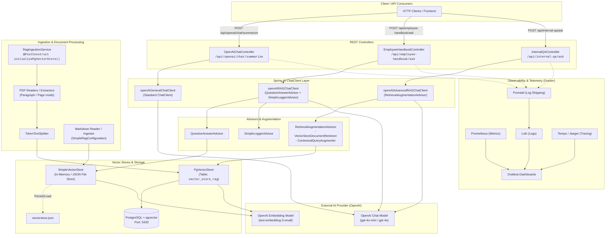

### Architectural Schema: GenAI Spring Boot Demo Project

This project is a Spring Boot application built with **Spring AI** that provides OpenAI-powered generative AI chat and Retrieval-Augmented Generation (RAG) capabilities with multiple vector store strategies (in-memory/file-based and PostgreSQL with `pgvector`), alongside document ingestion and full observability stacks.

---

### High-Level System Architecture Diagram



---

### Component Breakdown and Data Flows

#### 1. Direct LLM Chat Flow (`OpenAIChatController`)
- **Endpoint:** `POST /api/openai/chat/summarize`
- **Component:** `openAIGeneralChatClient`
- **Execution Path:**
  1. Receives input user prompt text.
  2. Directly delegates the prompt to OpenAI Chat Model via Spring AI `ChatClient`.
  3. Returns raw completions/summaries without augmentation.

#### 2. Simple RAG: Employee Handbook (`EmployeeHandbookController`)
- **Endpoint:** `POST /api/employee-handbook/ask`
- **Components:** `openAIRAGChatClient`, `QuestionAnswerAdvisor`, `SimpleLoggerAdvisor`, `SimpleVectorStore`.
- **Knowledge Base:** Local Markdown documents (`src/main/resources/rag/mini-employee-handbook/files/*.md`).
- **Execution Path:**
  1. On application startup, `SimpleRagConfiguration` checks for existing `vectorstore.json`. If absent or not initialized, it loads markdown files, chunks them with `TokenTextSplitter`, embeds them via OpenAI Embedding Model (`text-embedding-3-small`), and caches vectors to disk (`vectorstore.json`).
  2. When a user asks an HR question, `QuestionAnswerAdvisor` retrieves top-k matching document chunks from `SimpleVectorStore` based on similarity threshold.
  3. Augments the system prompt (`HR Assistant`) with the retrieved context and sends it to OpenAI Chat Model.
  4. `SimpleLoggerAdvisor` logs request and response interactions.

#### 3. Advanced RAG: Internal QA with PostgreSQL / PgVector (`InternalQAController`)
- **Endpoint:** `POST /api/internal-qa/ask` (supports optional `filter` query parameter).
- **Components:** `openAIAdvancedRAGChatClient`, `RetrievalAugmentationAdvisor`, `VectorStoreDocumentRetriever`, `ContextualQueryAugmenter`, `PgVectorStore`.
- **Knowledge Base:** Internal PDF files (`src/main/resources/rag/qa-over-internal-docs/*.pdf`).
- **Execution Path:**
  1. **Document Ingestion (`RagIngestionService`):**
     - Triggered automatically on startup via `@PostConstruct initializePgVectorStore()`.
     - Scans PDF internal documents.
     - Splits documents into chunks using `TokenTextSplitter`.
     - Attaches metadata (source, page index, chunk index).
     - Embeds and stores chunks in PostgreSQL table (`vector_store_rag`) via `PgVectorStore`.
  2. **Query Processing:**
     - `RetrievalAugmentationAdvisor` retrieves relevant document chunks via `VectorStoreDocumentRetriever` from `PgVectorStore` (with optional runtime metadata filtering).
     - `ContextualQueryAugmenter` formats and injects retrieved context with exact source citations `[source:filename.pdf, page_number:X]`.
     - Sends augmented prompt to OpenAI Chat Model and returns formatted answers with exact citations.

---

### Infrastructure & Supporting Services

```
┌────────────────────────────────────────────────────────────────────────┐
│                          Docker Infrastructure                         │
├───────────────────────────────────┬────────────────────────────────────┤
│           Data Storage            │       Observability & Metrics      │
├───────────────────────────────────┼────────────────────────────────────┤
│ • PostgreSQL 16 + pgvector        │ • Prometheus (metrics scraping)    │
│   - Port: 5433                    │ • Loki + Promtail (log aggregation)│
│   - Database: postgres            │ • Tempo + Jaeger (traces)          │
│   - Table: vector_store_rag       │ • Grafana (dashboards & alerts)    │
└───────────────────────────────────┴────────────────────────────────────┘
```

---

### Technology Stack Summary

- **Framework:** Spring Boot 3.x, Spring AI 1.x
- **Language:** Java 21+
- **AI Integrations:** OpenAI Chat (`gpt-4o-mini`), OpenAI Embeddings (`text-embedding-3-small`)
- **Vector Stores:** `SimpleVectorStore` (JSON-backed in-memory), `PgVectorStore` (PostgreSQL vector extension)
- **Document Extractors:** Apache PDFBox / Spring AI PDF Readers, Spring AI Markdown Reader, `TokenTextSplitter`
- **Database:** PostgreSQL with `pgvector`
- **Observability:** Prometheus, Grafana, Loki, Promtail, Tempo, Jaeger, Logback-Spring